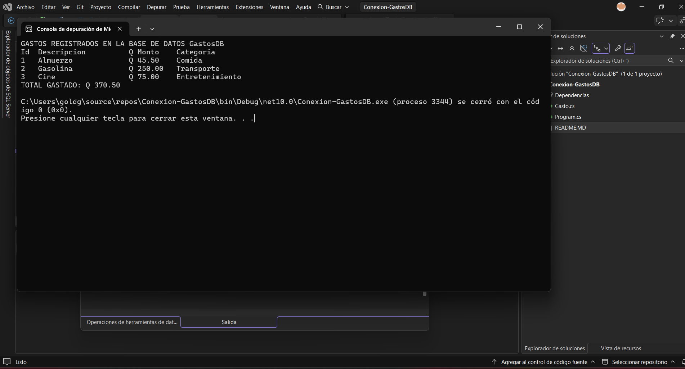
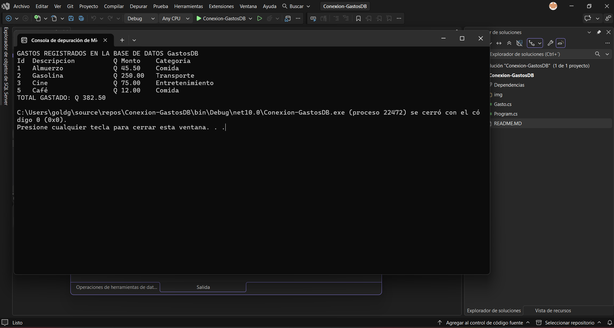
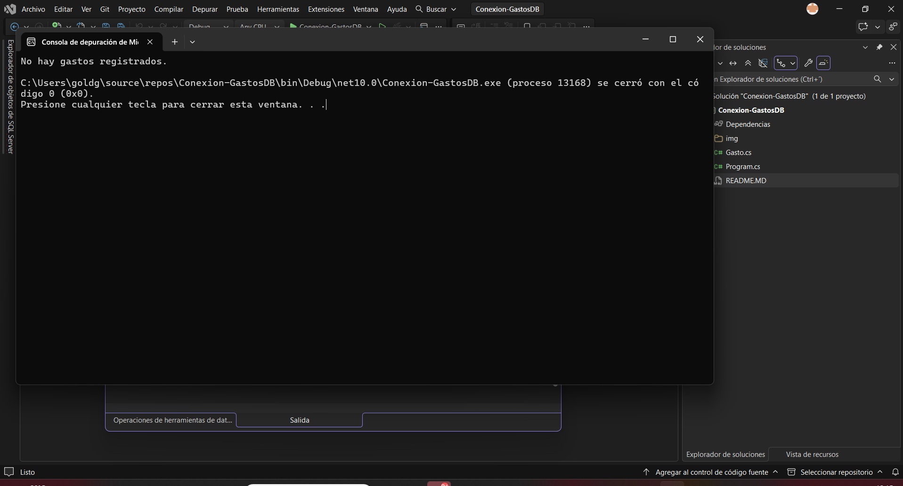
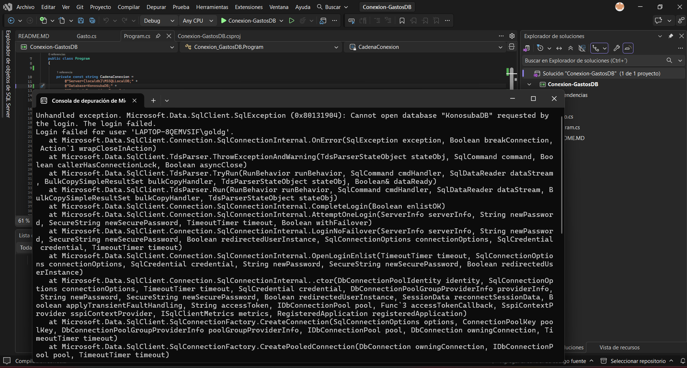

Conexión a Base de datos y lectura de registros

Cómo ejecutarlo

Abre el proyecto en Visual Studio Community y presiona F5.
O utiliza el comando dotnet run desde la terminal.

El programa da error porque al cambiar el nombre de la base de datos en el código, le estamos pidiendo al programa que se conecte a una que no existe, 
como el programa todavía no está preparado para manejar este tipo de fallos, la aplicación se cae.

